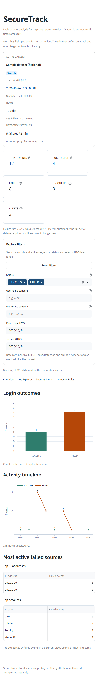

# SecureTrack — Stage 4 UI/UX Report

**Date:** 2026-10-28

**Scope:** Stage 4 presentation-layer refinement for the SecureTrack login-activity analyser.

**Status:** Complete. The approved Stage 3 parser, detection engine, export builders, validation rules, and evidence schema were preserved without modification. Stage 5 has not started.

---

## 1. Outcome

Stage 4 turns the prototype into a usable review interface without changing what the detector means or how it works.

Delivered changes:

- an explicit sample / upload / no-dataset state machine;
- genuine sample loading and a visible Clear dataset action;
- unambiguous upload precedence and stale-result prevention;
- active dataset metadata and coverage;
- username, IP, status, and UTC date-range exploration filters;
- consistent filtered Overview and Log Explorer views;
- alert filtering that selects displayed alerts without re-running detection;
- clearer High / Medium / Informational presentation;
- per-alert reasons, entities, episode ranges, peak values, thresholds, event counts, and evidence;
- a restrained light cybersecurity-academic visual treatment;
- responsive desktop, tablet, and phone layouts;
- readable charts for small datasets;
- removal of deprecated width arguments, including `use_container_width`.

No `core/` module changed during Stage 4.

---

## 2. Design direction

The interface is intentionally restrained:

- white surfaces, slate text, and a muted blue primary colour;
- green for successful outcomes and orange for failed outcomes;
- red, orange, and blue badges for High, Medium, and Informational states;
- consistent 8 px card radius, visible borders, and generous spacing;
- compact metric cards rather than oversized dashboard numbers;
- no gradients, shadows, animation, decorative icons, emojis, fake real-time indicators, or artificial-AI styling;
- review language throughout: alerts identify patterns for human review and do not confirm attacks.

The visual hierarchy is:

1. application purpose and review disclaimer;
2. active dataset and detection settings;
3. dataset-wide summary metrics;
4. exploration filters;
5. tabbed detail: Overview, Log Explorer, Security Alerts, Detection Rules.

---

## 3. Dataset lifecycle

The session state machine has three modes:

| Mode | Behaviour |
|---|---|
| `sample` | Default state; loads the fictional sample dataset |
| `upload` | An uploaded CSV takes precedence over the sample |
| `none` | True empty state with no metrics, filters, or alerts |

Key behaviours:

- `Load sample` increments the uploader nonce, clears the file input, resets filters, and loads the sample.
- `Clear dataset` moves to `none`; it does not silently fall back to the sample.
- Removing an active upload moves to `none` and clears stale results.
- Uploading a new file changes the dataset identity and forces a fresh detection run.
- Invalid, header-only, oversized, and unreadable datasets show validation state only. Stale metrics and alerts are never rendered.
- Dataset identity is `sample:<mtime_ns>:<size>` or `upload:<sha256>`.
- Parsing is cached with `st.cache_data` keyed by raw bytes and source name.
- Detection is memoized by dataset identity plus all four detection settings.
- Filter changes do not re-run detection.
- The active source is shown in the sidebar and in the dataset bar, with UTC coverage, valid rows, skipped rows, file size, data-row count, and current thresholds.

---

## 4. Exploration filters

The shared filter block contains:

- **Status** — multi-select for `SUCCESS` / `FAILED`; clearing the selection shows no events rather than treating it as “all”.
- **Username contains** — case-insensitive substring search.
- **IP address contains** — case-insensitive substring search.
- **From date (UTC)** and **To date (UTC)** — inclusive full UTC days.
- **Reset filters** — removes all `filter_` session keys.

Filter state is scoped by a dataset token, so a new upload or sample reload starts clean. A reversed date range and an empty status selection show explicit warnings.

The filters affect:

- Overview charts;
- top IP and account tables;
- Log Explorer rows;
- which already-detected alerts are displayed.

They do **not** affect detection or the evidence inside an alert. Top-line metrics remain dataset-wide and the caption says so. Detection continues to use the full active dataset, and every alert keeps its complete episode evidence.

---

## 5. Alerts and evidence

The Security Alerts tab opens with:

- an Informational badge explaining that alerts are review indicators;
- High, Medium, and displayed-alert counts;
- a compact alert-summary table;
- displayed-alert and displayed-evidence CSV downloads;
- one detailed card per displayed alert.

Each alert card shows:

- stable alert ID and alert type;
- affected IP or account;
- severity badge;
- why the alert was generated;
- episode event count;
- peak events or peak distinct accounts;
- threshold and window;
- episode start/end and peak-window start/end;
- distinct source IPs or accounts where relevant;
- a supporting-evidence expander with source row, timestamp, account, IP, and status;
- a per-alert safe CSV evidence download.

Evidence is intentionally the complete episode even when filters hide some events. The display caps the visible evidence table at 500 rows, while the download contains the full evidence set.

The severity guide explains that High means the peak reached at least twice the configured threshold and Medium means the threshold was met. Neither is presented as a probability that an attack occurred.

No-match states explain that zero alerts does not prove the absence of an attack. Shared networks, NAT, testing, and mistyped passwords can also produce failures.

---

## 6. Empty and invalid states

The `none` state shows a dedicated **No dataset loaded** panel with a visible **Load sample dataset** action.

Invalid uploads show:

- an error banner;
- a source and file-size line;
- the first validation issue;
- an expanded validation table;
- **Load sample dataset** and **Clear dataset** recovery actions.

The invalid state contains no metrics, charts, filters, or alert cards from the previous dataset.

---

## 7. Responsive layout and charts

Breakpoints are intentionally simple:

| Width | Metric layout | Other behaviour |
|---|---|---|
| Above 1000 px | 5 cards in one row | Sidebar expanded |
| 481–1000 px | 2 cards per row | Dataset/filter blocks wrap as needed |
| 480 px and below | 1 card per row | Sidebar starts collapsed; tabs fit or scroll |

Additional behaviour:

- `initial_sidebar_state="auto"` keeps the sidebar available on desktop and collapsed on phones.
- Metric labels remain full-length at tablet widths after moving from 3+2 to 2+2+1.
- All four tab labels fit at 390 px; the tab list can scroll if needed.
- Charts stack on phones and remain side by side at tablet/desktop widths.
- Plotly mode bars are hidden for a cleaner, less decorative presentation.
- Chart fonts, grid colours, axis labels, integer event ticks for small datasets, and adaptive time buckets are shared through `ui/theme.py`.
- Timeline labels show values when the bucket count is small enough to avoid clutter.

---

## 8. Accessibility and compatibility

- Light theme with dark slate text on white/near-white surfaces.
- Explicit labels, help text, and captions for metrics, filters, thresholds, and evidence.
- Status and severity are conveyed with text, not colour alone.
- Informational states use dedicated badges and captions.
- Alert/source text is escaped before Markdown rendering.
- `st.badge` is used consistently for dataset, rule, severity, and informational states.
- All `use_container_width` usage is removed.
- `width="stretch"` is used where the installed Streamlit API supports it.
- The Streamlit toolbar is hidden and usage stats are disabled in `.streamlit/config.toml`.
- Uploads are limited to 5 MB in both Streamlit configuration and parser safeguards.

---

## 9. Validation

### Automated tests

```powershell
python -m pytest -q -W error
```

Result:

```text
112 passed
```

Stage 3 finished with 100 tests. Stage 4 adds twelve presentation-layer tests and keeps the suite warnings-as-errors clean.

The AppTest smoke run reports:

```text
exceptions: 0
errors: 0
top metrics: Total events=12, Successful=4, Failed=8, Unique IPs=3, Alerts=3
tabs: Overview, Log Explorer, Security Alerts, Detection Rules
dataframes: 7
charts: 2
download buttons: 6
```

### Browser checks

| Scenario | Result |
|---|---|
| Sample | 12 events, 4 successes, 8 failures, 3 IPs, 3 alerts |
| Mixed upload | 23 events, 3 successes, 20 failures, 5 IPs, 5 alerts; 2 High and 3 Medium |
| Clear dataset | No dataset state; no metrics |
| Clear → Load sample | Original sample metrics restored |
| Username `alex` | 6 of 12 events; 2 of 3 alerts displayed |
| Success-only status | No alerts displayed; clear recovery action shown |
| Small upload | 1 event, 1 success, 0 failures, 1 IP, 0 alerts |
| Large upload | 10,000 events, 9,900 successes, 100 failures, 50 IPs, 0 alerts |
| Header-only upload | Validation error only; no stale metrics |
| Invalid upload | `invalid IP address`; no stale metrics; recovery actions available |
| Tablet 860 px | Two metric cards per row with full labels |
| Phone 390 px | Sidebar collapsed, one metric per row, tabs reachable, charts stacked |

---

## 10. Screenshots

All screenshots are stored in `docs/screenshots/` and were captured from the live app in headless Chrome. The capture tooling is for documentation only and is not part of the application runtime or test suite.

### Desktop

[](docs/screenshots/01_overview.png)

*Overview: dataset metadata, dataset-wide metrics, filters, login outcomes, timeline, and top failed sources.*

[](docs/screenshots/02_log_explorer.png)

*Log Explorer: source-row traceability, UTC timestamps, account, IP, status, and filtered CSV download.*

[](docs/screenshots/03_security_alerts.png)

*Security Alerts: informational scope note, severity counts, summary table, and alert detail cards.*

[](docs/screenshots/04_alert_evidence.png)

*Alert evidence: complete episode with source rows and a per-alert download.*

[](docs/screenshots/05_detection_rules.png)

*Detection Rules: configured rules, episode semantics, severity guide, and limitations.*

[](docs/screenshots/06_no_dataset.png)

*Empty state: no stale results and a visible sample-loading action.*

[](docs/screenshots/07_filtered_log_explorer.png)

*Filtered Log Explorer: username search shows 6 of 12 events while retaining source rows.*

[](docs/screenshots/08_upload_alerts_high_and_medium.png)

*Uploaded dataset with High and Medium alerts; the active upload is shown in the dataset bar.*

[](docs/screenshots/09_upload_alert_evidence.png)

*Uploaded high-priority alert with complete evidence and download.*

[](docs/screenshots/12_invalid_upload.png)

*Invalid upload: actionable validation state with no stale analysis.*

### Responsive

[](docs/screenshots/11_tablet_overview.png)

*Tablet at 860 px: two metric cards per row with full labels.*

[](docs/screenshots/10_mobile_overview.png)

*Compact 500 px layout: two cards per row and stacked charts.*

[](docs/screenshots/13_mobile_390_top.png)

*Phone at 390 px: collapsed sidebar, single-column metrics, and readable filters.*

[](docs/screenshots/14_mobile_390_charts.png)

*Phone charts: all four tabs fit, charts stack, and small-dataset ticks stay readable.*

---

## 11. Changed files

| File | Change |
|---|---|
| `app.py` | Dataset state machine, filters, charts, alert cards, responsive layout, caching |
| `ui/filters.py` | New pure filter, alert-selection, timeline, and display-summary helpers |
| `ui/theme.py` | New light theme, chart styling, responsive CSS, Markdown escaping |
| `ui/__init__.py` | New UI package marker |
| `.streamlit/config.toml` | Light theme, hidden toolbar usage stats, 5 MB upload cap |
| `tests/test_app.py` | Expanded AppTest interaction coverage |
| `tests/test_ui_filters.py` | New filter/helper tests |
| `docs/screenshots/*.png` | Fourteen documentation screenshots |
| `IMPLEMENTATION_REPORT.md` | Stage 4 implementation and validation update |
| `UI_REPORT.md` | This report |

No `core/` module, dependency, detection threshold, or episode semantic changed in Stage 4.

---

## 12. Deliberate limitations

- SecureTrack is a local academic prototype; there is no authentication or production deployment hardening.
- It analyses uploaded or sample files only. It does not monitor live traffic, block IPs, lock accounts, or confirm attacks.
- Filters are presentation-only; detection always uses the full active dataset.
- The evidence table shows at most 500 rows per alert, while the per-alert CSV contains the complete episode.
- Multiline CSV fields remain rejected to preserve physical `source_row` traceability.
- `README.md` and final user documentation remain Stage 5 work.

---

## 13. Status

Stage 4 is complete and intentionally stopped before Stage 5.
