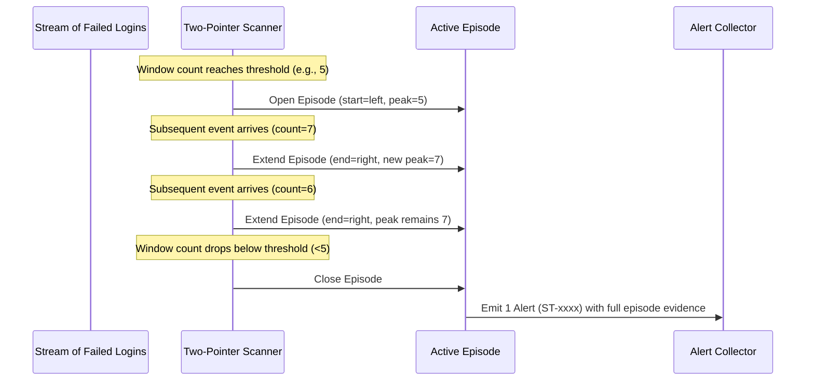

# SecureTrack — Detection Logic & Rules Reference

**Module:** `core/detection.py`  
**Application:** SecureTrack — Login Activity Analyzer  
**Scope:** Rule-based detection algorithms, sliding-window logic, episode formation, and severity scoring.

---

## 1. Overview & Detection Principles

SecureTrack employs **transparent, rule-based sliding-window algorithms** to flag suspicious authentication activity. 

Key design principles:
- **No Black-Box Models:** No artificial intelligence, black-box machine learning, or opaque statistical scoring is used. Every alert can be verified mathematically against the raw event log.
- **Human-in-the-Loop Triage:** Alerts are **indicators for human investigation**, not proof of an active attack. Legitimate operational conditions (e.g., mistyped passwords, NAT firewalls) can trigger similar patterns.
- **One Alert Per Episode:** Rather than flooding analysts with a new alert for every qualifying sliding window, contiguous qualifying windows are merged into a single **episode** with peak metrics and complete supporting evidence.
- **Deterministic Performance ($O(N)$ Scanning, $O(N \log N)$ Pipeline):** All detection rules utilize two-pointer sliding windows that process sorted failure events in strict $O(N)$ linear time. Accounting for chronological mergesort during preprocessing, the end-to-end detection pipeline executes in $O(N \log N)$ time, eliminating the quadratic $O(N^2)$ slowdown of earlier versions.

---

## 2. Detection Rules & Identifiers

| Rule ID | Human-Readable Alert Type | Primary Entity | Trigger Condition |
|---|---|---|---|
| `R1_IP_FAILURES` | Repeated failed logins from one IP | Source IP address | $\ge K_1$ failed logins from the same IP within a sliding window of $W_1$ minutes. |
| `R2_ACCOUNT_FAILURES` | Repeated failed logins against one account | Target username | $\ge K_1$ failed logins targeting the same username within a sliding window of $W_1$ minutes. |
| `R3_ACCOUNT_SPRAY` | Multiple accounts targeted by one IP | Source IP address | $\ge K_2$ **distinct** usernames targeted with failed logins from the same IP within a sliding window of $W_2$ minutes. |

### Configurable Parameters & Defaults

| Parameter | Default Value | Valid Range | Applicable Rules | UI Input Control |
|---|---|---|---|---|
| `threshold` ($K_1$) | `5` failures | Integer $\ge 2$ | `R1_IP_FAILURES`, `R2_ACCOUNT_FAILURES` | Sidebar: "Failed attempts threshold" |
| `window_minutes` ($W_1$) | `2.0` minutes | Float $> 0$ | `R1_IP_FAILURES`, `R2_ACCOUNT_FAILURES` | Sidebar: "Time window (minutes)" |
| `spray_users` ($K_2$) | `3` distinct accounts | Integer $\ge 2$ | `R3_ACCOUNT_SPRAY` | Sidebar: "Distinct accounts threshold" |
| `spray_window_minutes` ($W_2$) | `5.0` minutes | Float $> 0$ | `R3_ACCOUNT_SPRAY` | Sidebar: "Account-spray window (minutes)" |

---

## 3. Sliding-Window & Episode Formation Logic

### 3.1 Two-Pointer Sliding Window

For any entity (IP address or username), failed events are first sorted chronologically by UTC timestamp. A two-pointer sliding window $[left, right]$ iterates across the event list:

1. The `right` pointer advances one event at a time ($t_{right}$).
2. The `left` pointer advances until $(t_{right} - t_{left}) \le W_{seconds}$. Window boundaries are inclusive: an event occurring exactly $W$ seconds after $t_{left}$ is included in the window.
3. The count of events within the window is:
   $$\text{count} = right - left + 1$$

```text
Time Line:  ----[ Event L ------------ Event R ]----->
            |<- - - - - Window <= W - - - - - ->|
```

### 3.2 Episode Formation & Peak Tracking

In high-volume scenarios (e.g. 50 failed attempts over 3 minutes), an entity might satisfy the threshold across dozens of overlapping sliding windows. Generating an alert for each window produces alert fatigue and overwrites previous evidence.

SecureTrack resolves this through **Episode Grouping**:
- An **Episode** starts at the first window where $\text{count} \ge \text{threshold}$.
- As the window slides forward, if subsequent windows continue to satisfy $\text{count} \ge \text{threshold}$, they are absorbed into the ongoing episode. The episode boundary extends to cover all qualifying events.
- The engine records the **Peak Sub-Window**: the exact interval $[peak\_start, peak\_end]$ where the maximum count ($\text{peak}$) occurred.
- When the count drops below $\text{threshold}$ (or events are exhausted), the episode is closed and emitted as exactly **one alert**.



### 3.3 Computational Complexity Analysis

Understanding the end-to-end computational complexity requires auditing every phase of `detect_suspicious_activity()`:

1. **Filtering & Preprocessing ($O(N)$):**
   Filtering for `status == "FAILED"` and grouping by entity (`ip_address` or `username`) operates in $O(N)$ time where $N$ is the total count of failed login events.
2. **Chronological Sorting ($O(N \log N)$):**
   Events within each entity group are sorted by `["timestamp", "source_row"]` using stable `mergesort`. For a group of size $M_i$, sorting takes $O(M_i \log M_i)$. Summing across all groups yields:
   $$\sum_{i} O(M_i \log M_i) \le O(N \log N)$$
3. **Sliding-Window Scanning ($O(N)$):**
   In both `_scan_threshold_episodes()` and `_scan_spray_episodes()`, both the `left` and `right` pointers advance monotonically from $0$ to $M_i$. Neither pointer ever decrements. In `_scan_spray_episodes()`, the sliding username frequency dictionary (`collections.Counter`) inserts and deletes keys in amortized $O(1)$ time. Thus, the scanning phase across all groups is strictly **linear time: $O(N)$**.
4. **Alert Sorting ($O(A \log A)$):**
   The generated alerts are sorted by severity and timestamp. For $A$ emitted alerts ($A \ll N$), this takes $O(A \log A)$ time.

**Conclusion:** The algorithmic core (sliding-window episode scanning) is strictly **$O(N)$ linear time**, while the complete pipeline (including chronological sorting) has an overall computational complexity of **$O(N \log N)$**. Both in-memory space complexity and evidence storage are bounded by $O(N)$.

---

## 4. Rule Implementations

### 4.1 Rule 1: `R1_IP_FAILURES`
- **Goal:** Identify brute-force authentication attacks originating from a single host or bot.
- **Grouping:** All `FAILED` events grouped by `ip_address`.
- **Logic:**
  ```python
  for episode in _scan_threshold_episodes(times, threshold, window_seconds):
      # Generates alert for single IP host
  ```
- **Alert Attributes:**
  - `entity_type`: `"ip"`
  - `entity_value`: IP string (e.g., `192.0.2.20`)
  - `peak_window_count`: Maximum failed logins in any $W_1$ window during the episode.
  - `event_count`: Total failed logins in the entire episode.

### 4.2 Rule 2: `R2_ACCOUNT_FAILURES`
- **Goal:** Identify targeted password-guessing attacks against a single user account, regardless of whether attempts originate from one IP or a distributed proxy network.
- **Grouping:** All `FAILED` events grouped by `username`.
- **Logic:**
  ```python
  for episode in _scan_threshold_episodes(times, threshold, window_seconds):
      # Generates alert for targeted account
  ```
- **Alert Attributes:**
  - `entity_type`: `"username"`
  - `entity_value`: Username string (e.g., `admin`)
  - `distinct_source_ips`: Number of distinct source IP addresses participating in the attack.
  - `peak_window_count`: Maximum failed logins against this account in any $W_1$ window.

### 4.3 Rule 3: `R3_ACCOUNT_SPRAY`
- **Goal:** Detect password-spraying attacks where an adversary tries a few common passwords across many different accounts from a single host to avoid triggering per-account lockout thresholds.
- **Grouping:** All `FAILED` events grouped by `ip_address`.
- **Logic:**
  A sliding counter (`collections.Counter`) tracks the frequencies of distinct usernames within the $[left, right]$ window.
  - When `right` advances, if the username count was 0, `distinct` is incremented.
  - When `left` advances, the count for the expired username is decremented; if it reaches 0, it is removed and `distinct` is decremented.
  - If $\text{distinct} \ge spray\_users$, an episode is opened or extended.
  - Repeated attempts against the same username do not artificially inflate the distinct account count.
- **Alert Attributes:**
  - `entity_type`: `"ip"`
  - `entity_value`: IP string (e.g., `192.0.2.30`)
  - `distinct_accounts`: Total distinct usernames targeted throughout the entire episode.
  - `peak_distinct_accounts`: Maximum distinct usernames targeted within any single $W_2$ window.

---

## 5. Severity Classification Scheme

SecureTrack assigns severity deterministically based on the ratio between the observed peak activity and the configured threshold:

$$\text{Severity} = \begin{cases} 
\mathbf{High} & \text{if } \text{peak} \ge 2 \times \text{threshold} \\ 
\mathbf{Medium} & \text{if } \text{threshold} \le \text{peak} < 2 \times \text{threshold} 
\end{cases}$$

### Examples

| Rule | Threshold Configured | Peak Observed | Severity Assigned | Operational Meaning |
|---|---|---|---|---|
| `R1_IP_FAILURES` | 5 failures / 2 min | 6 failures / 2 min | **Medium** | Moderate volume; exceeds baseline threshold. |
| `R1_IP_FAILURES` | 5 failures / 2 min | 12 failures / 2 min | **High** | High-velocity brute force ($\ge 2 \times$ baseline). |
| `R3_ACCOUNT_SPRAY` | 3 accounts / 5 min | 3 accounts / 5 min | **Medium** | Baseline spray threshold satisfied. |
| `R3_ACCOUNT_SPRAY` | 3 accounts / 5 min | 6 accounts / 5 min | **High** | Aggressive horizontal spray ($\ge 2 \times$ baseline). |

> [!NOTE]
> **Severity is Not Attack Probability:** High severity denotes higher event volume relative to the configured threshold. It does not mean the system has statistically verified an adversarial breach.

---

## 6. Alert Prioritization & Output Schema

Alerts returned by `detect_suspicious_activity()` are sorted deterministically:
1. Severity (`High` preceding `Medium`).
2. Episode start timestamp (`start_time` ascending).
3. Rule ID (`rule_id` ascending).
4. Entity identifier (`entity_value` ascending).

Sequential, human-readable IDs (`ST-0001`, `ST-0002`, etc.) are assigned after sorting.

### Alert Dictionary Schema

```json
{
  "alert_id": "ST-0001",
  "rule_id": "R1_IP_FAILURES",
  "alert_type": "Repeated failed logins from one IP",
  "entity_type": "ip",
  "entity_value": "192.0.2.20",
  "severity": "High",
  "start_time": "2026-10-24T18:32:00+00:00",
  "end_time": "2026-10-24T18:33:20+00:00",
  "event_count": 5,
  "peak_window_start": "2026-10-24T18:32:00+00:00",
  "peak_window_end": "2026-10-24T18:33:20+00:00",
  "peak_window_count": 5,
  "threshold": 5,
  "window_minutes": 2.0,
  "description": "5 failed login events from 192.0.2.20; peak 5 events within a 2-minute window (threshold 5).",
  "evidence": [
    {
      "source_row": 4,
      "timestamp": "2026-10-24 18:32:00+00:00",
      "username": "alex",
      "ip_address": "192.0.2.20",
      "status": "FAILED"
    }
  ]
}
```

---

## 7. False Positives & Operational Considerations

When triaging alerts in SecureTrack, security analysts should consider benign causes:

1. **Shared NAT Gateways & Corporate Proxies (`R1_IP_FAILURES`):**
   In enterprise environments or universities, hundreds of legitimate users egress through a small pool of shared public IP addresses. Multiple users mistyping passwords during peak hours can trigger an IP failure alert without malicious intent.

2. **Automated Integration & Service Accounts (`R2_ACCOUNT_FAILURES`):**
   A script, mobile application, or email client configured with an expired password or rotated token can repeatedly fail authentication every few seconds.

3. **Shared Lab Workstations & Kiosks (`R3_ACCOUNT_SPRAY`):**
   A physical computer terminal in a public library or university laboratory where successive students attempt to log in with forgotten credentials can trigger account-spray rules from a single IP.

4. **Penetration Testing & Vulnerability Scanners:**
   Authorized security assessments and automated credential scanners will trigger high-volume alerts across all three rules.
