# SecureTrack — User Guide & Workflow Walkthrough

**Application:** SecureTrack — Login Activity Analyzer & Suspicious Login Detection System  
**Audience:** Security Analysts, Incident Responders, System Administrators, Academic Evaluators  

---

## 1. Quickstart & Application Launch

### Launching the Dashboard

Open a terminal (PowerShell or Bash) in the project directory with your virtual environment active, and launch Streamlit:

```powershell
streamlit run app.py
```

The application will start and automatically open in your default browser at:
```text
http://localhost:8501
```

---

## 2. Interface Layout & Navigation

The SecureTrack interface is divided into functional visual zones:

1. **Sidebar Controls (Left):**
   - **Dataset Management:** File uploader, dataset status badge, "Load sample", and "Clear dataset" buttons.
   - **Detection Settings:** Configurable thresholds and sliding-window duration inputs.
   - **Review Disclaimer:** Academic usage guidelines.
2. **Top Information Bar:** Displays the active dataset source name, UTC time range coverage, valid/skipped row counts, and current threshold configuration.
3. **Top Metrics Row:** High-level summary of total events, successful logins, failed logins, distinct IP addresses, and detected alerts.
4. **Exploration Filters Bar:** Global search by status, username substring, IP substring, and UTC date ranges.
5. **Tabbed Analysis Views:**
   - **Overview:** Interactive Plotly charts (Login outcome distribution, timeline of authentication attempts, and top sources of failed logins).
   - **Log Explorer:** Searchable, sortable tabular view of ingested logs with source-row traceability.
   - **Security Alerts:** Detailed episode review cards, severity badges, and drill-down evidence tables.
   - **Detection Rules:** Reference documentation of active detection logic, thresholds, and limitations.

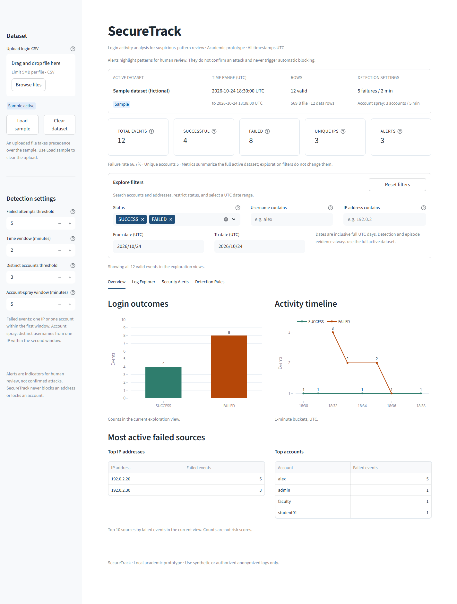
*Figure 1: SecureTrack dashboard overview with the fictional sample dataset loaded.*

---

## 3. Managing Datasets

### 3.1 Loading the Sample Dataset
SecureTrack includes a fictional authentication dataset (`data/sample_login_logs.csv`) containing 12 events using RFC 5737 TEST-NET-1 IP addresses (`192.0.2.0/24`).
- Upon initial startup, the sample dataset is loaded automatically.
- To reload the sample at any point, click **Load sample** in the sidebar. This clears any active file upload and resets all exploration filters.

### 3.2 Uploading Custom CSV Logs
1. Click **Browse files** or drag-and-drop a CSV into the sidebar file uploader.
2. The file must contain columns: `timestamp, username, ip_address, status` (Max 5 MB, Max 50,000 rows).
3. **Upload Precedence:** An uploaded file immediately takes precedence over the sample dataset. The active badge switches from blue ("Sample active") to green ("Upload active").

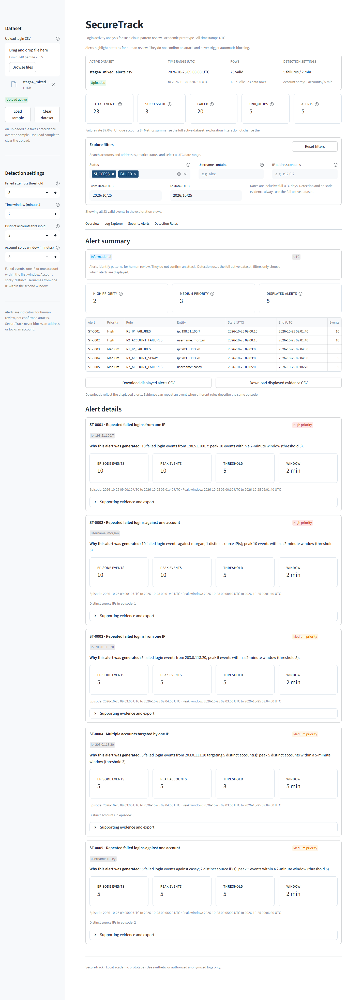
*Figure 2: Active uploaded dataset displaying High and Medium severity alerts.*

### 3.3 Clearing Datasets & Empty States
- Click **Clear dataset** in the sidebar to remove the active dataset.
- The interface cleanly transitions to a dedicated empty state ("No dataset loaded") with zero stale metrics or ghost alerts.
- A prominent **Load sample dataset** button allows quick recovery.

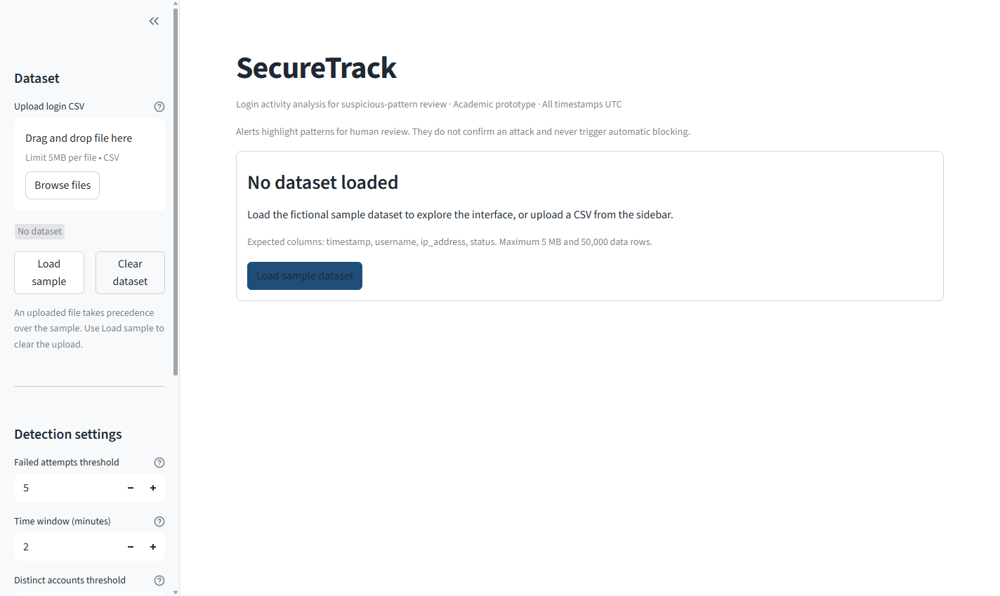
*Figure 3: Dedicated empty state when no dataset is loaded.*

### 3.4 Handling Malformed or Invalid Files
If an uploaded file has missing columns, invalid IPs, or unreadable timestamps:
- SecureTrack displays a clear amber or red error banner.
- An expandable **View validation issues** table details the exact CSV row number and reason for each skipped row.
- If all rows are invalid or required headers are missing, analysis is cleanly halted without application crashes.

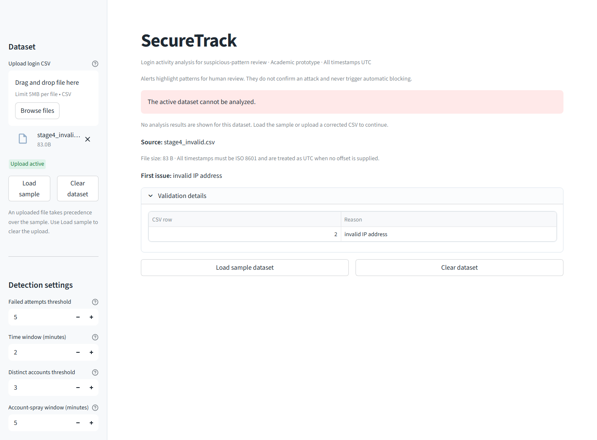
*Figure 4: Informative validation error display when an invalid CSV is uploaded.*

---

## 4. Exploring Authentication Logs

Switch to the **Log Explorer** tab to inspect individual log records:
- **Traceability:** Every event displays its 1-based `Source row` matching the original CSV line number.
- **Normalized Timestamps:** All dates and times are displayed in UTC (`YYYY-MM-DD HH:MM:SS UTC`).
- **Exporting Logs:** Click **Download filtered logs (CSV)** to export the currently filtered table as a formula-safe CSV file.

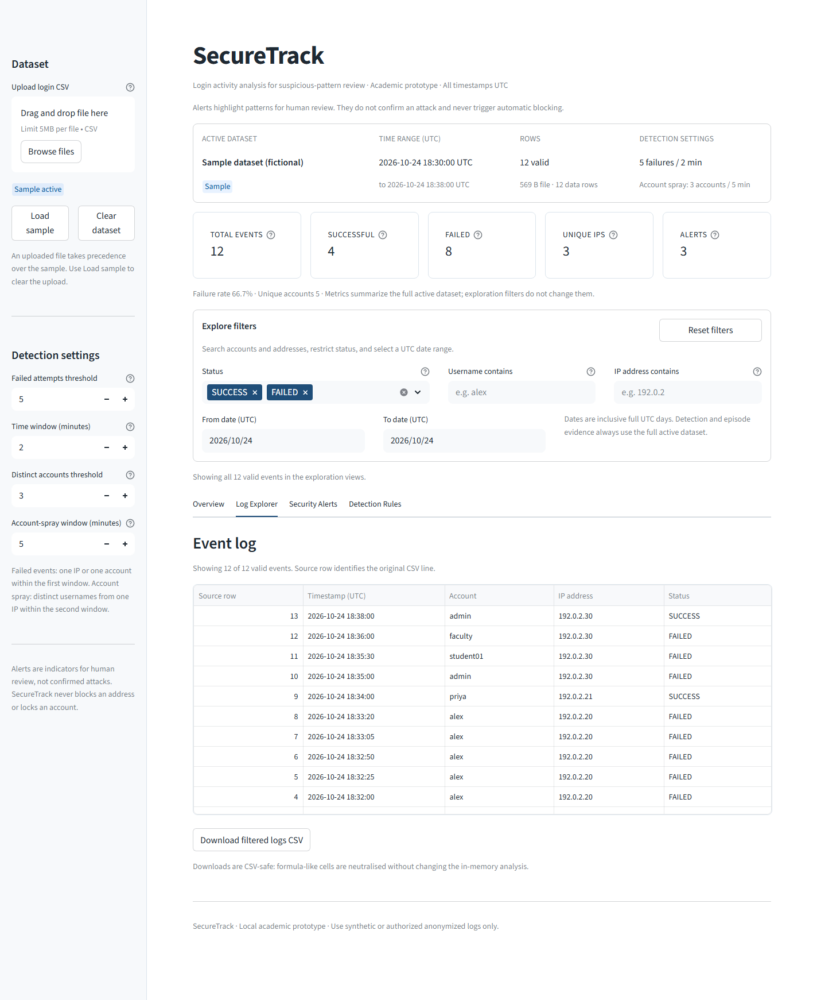
*Figure 5: Log Explorer tab with source-row numbers and full event attributes.*

---

## 5. Applying Exploration Filters

The filter bar allows real-time interactive slicing of the dataset:
- **Status:** Filter by `SUCCESS` or `FAILED` (or both).
- **Username contains:** Case-insensitive substring search (e.g. typing `alex` matches `alex`, `alexandra`).
- **IP address contains:** Substring search (e.g. typing `192.0.2.` matches the entire subnet).
- **Date Range (UTC):** Select Start and End dates to restrict the time window.
- **Reset Filters:** Click **Reset filters** to restore full dataset views.

> [!NOTE]
> **Exploration Filters Do Not Re-Run Detection:**  
> Filters change what is *displayed* in charts, tables, and which alert cards are visible. They do **not** re-run detection algorithms or truncate the underlying evidence stored within an alert.

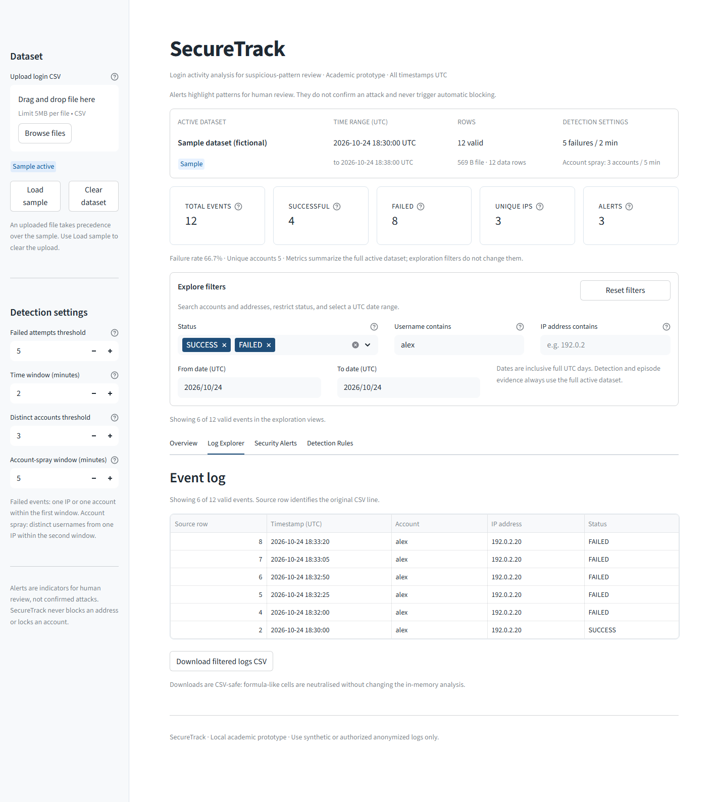
*Figure 6: Log Explorer filtered by username "alex", showing 6 of 12 events while retaining original source-row numbers.*

---

## 6. Reviewing Security Alerts

Switch to the **Security Alerts** tab to triage flagged suspicious episodes.

### 6.1 Alert Severity & Summary Table
- **Informational Banner:** Reminds analysts that alerts represent review indicators requiring triage, not confirmed attacks.
- **Severity Counters:** Displays counts of `High`, `Medium`, and total displayed alerts.
- **Alert Summary Table:** A compact tabular overview showing Alert ID, Type, Entity, Severity, Event Count, Peak Window, and Episode Range.

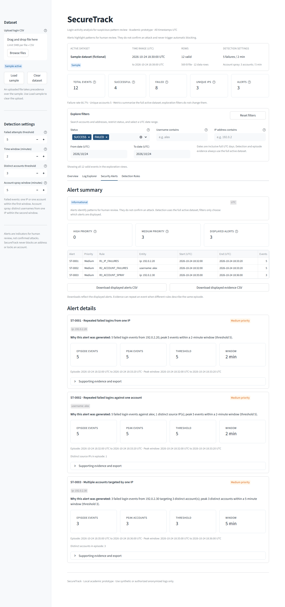
*Figure 7: Security Alerts tab with summary table, severity counts, and alert cards.*

### 6.2 Deep Dive into Alert Evidence
Each alert card provides granular details:
- **Alert ID & Type:** Sequential identifier (e.g. `ST-0001`) and human-readable rule name.
- **Entity & Severity Badge:** Targeted IP or username and severity (`High` or `Medium`).
- **Description:** Clear explanation of why the episode was flagged, including peak volume vs configured threshold.
- **Metrics Breakdown:** Total episode events, peak events in window, episode start/end times (UTC), and distinct targets or IPs.
- **Supporting Evidence Expander:** Click **Supporting evidence** to view an expandable table of all failed events within the episode, complete with `source_row` line numbers.
- **Per-Alert Safe Export:** Click **Download alert evidence (CSV)** on any card to export that episode's evidence directly.

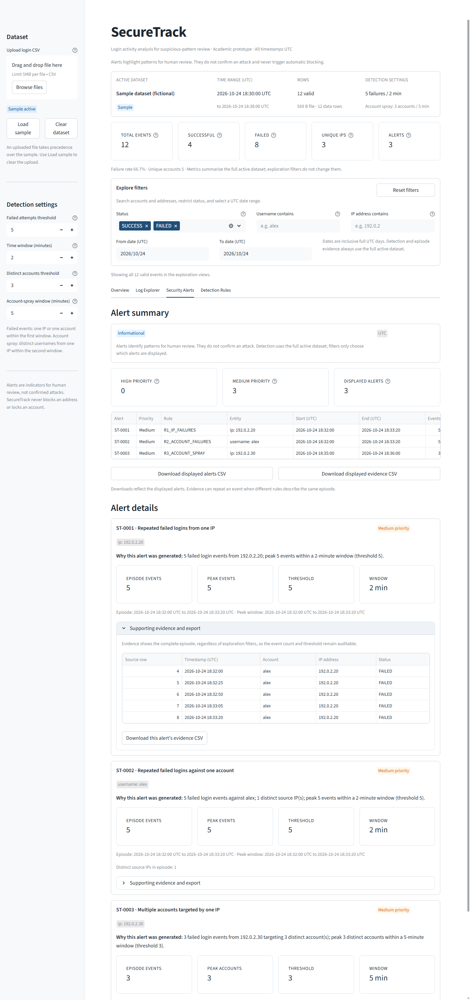
*Figure 8: Alert card expanded to show complete episode evidence with source-row traceability.*

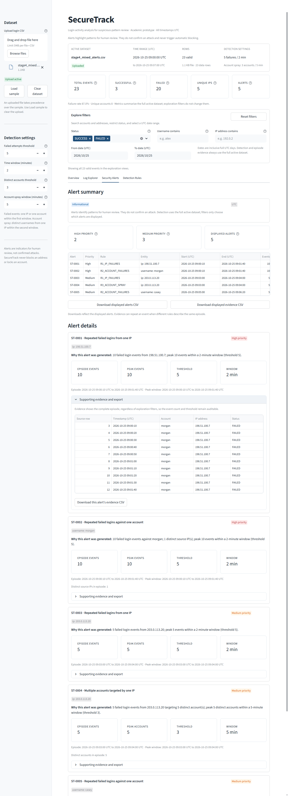
*Figure 9: High-severity alert drilldown with peak metrics and safe evidence download.*

---

## 7. Reviewing Detection Rules & Settings

Switch to the **Detection Rules** tab to inspect the exact logic and thresholds governing the active session:
- Explains `R1_IP_FAILURES`, `R2_ACCOUNT_FAILURES`, and `R3_ACCOUNT_SPRAY`.
- Details the mathematical formula for severity classification.
- Lists the active thresholds configured in the sidebar.
- Provides context on potential false positives (e.g., shared NAT gateways, user typos).

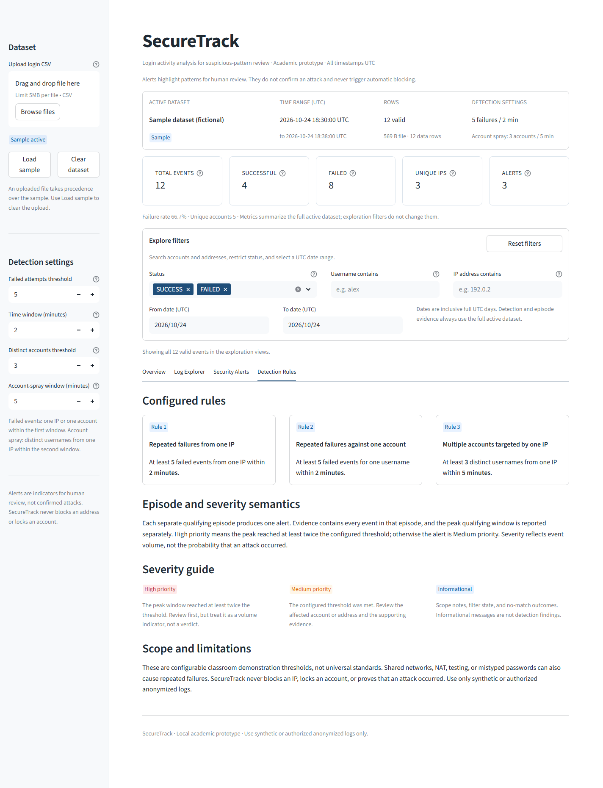
*Figure 10: Detection Rules reference tab explaining active rules and thresholds.*

---

## 8. Exporting Reports

SecureTrack provides three safe CSV export options:
1. **Download filtered logs (CSV):** Located in the Log Explorer tab; exports currently filtered log events.
2. **Download alert summary (CSV):** Located in the Security Alerts tab; exports a high-level summary of all displayed alerts (without evidence rows).
3. **Download all alert evidence (CSV):** Located in the Security Alerts tab; exports a flattened table linking every alert to each of its constituent evidence events.
4. **Download alert evidence (CSV):** Located on each individual alert card; exports only that alert's specific evidence.

> [!TIP]
> **Spreadsheet Safety Guarantee:**  
> All exported CSVs are automatically sanitized against Spreadsheet Formula Injection (CSV Injection). Text fields starting with `=`, `+`, `-`, or `@` are safely prefixed with an apostrophe (`'`), protecting analysts opening files in Excel or Google Sheets.

---

## 9. Responsive Layouts (Mobile & Tablet)

SecureTrack dynamically adapts across device viewports:
- **Desktop (>1000px):** 5 metric cards in one row, sidebar expanded, charts side by side.
- **Tablet (481px–1000px):** 2 metric cards per row with full labels, charts side by side.
- **Mobile ( $\le$ 480px):** Sidebar collapsed, 1 metric card per row, charts stacked vertically, tabs scrollable.

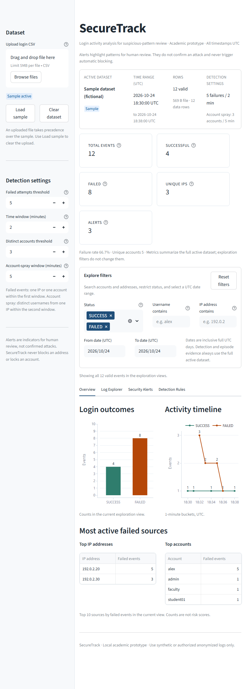
*Figure 11: Tablet layout (860px) showing 2 metric cards per row and full-length labels.*

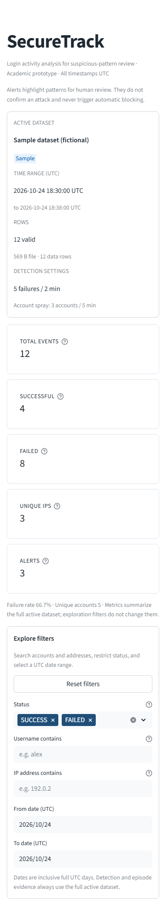
*Figure 12: Mobile view (390px) with single-column metrics and collapsed sidebar.*

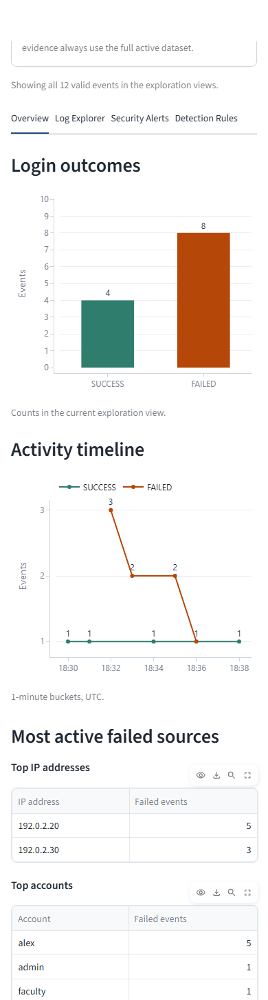
*Figure 13: Mobile view charts stacked vertically with integer ticks for small datasets.*
